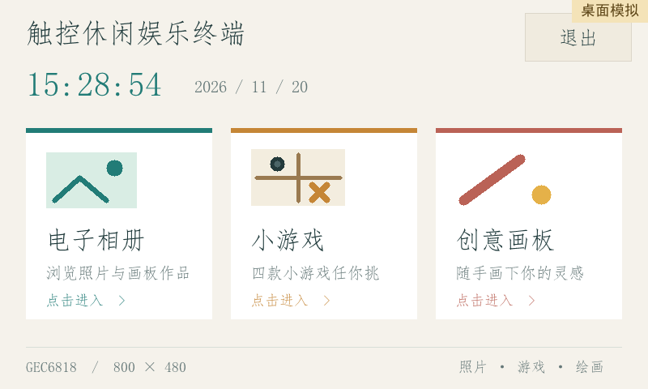

# 基于嵌入式 Linux 的交互式多媒体终端设计与实现

面向 **GEC6818 / 800×480 触摸屏**，基于用户提供的谢东宏、肖林祥两份多媒体终端工程改编。保留时钟主页、电子相册、四款小游戏（2048／五子棋／井字棋／中国象棋）与创意画板，取消音乐与视频模块。原工程保留在工作区原目录。

当前已通过 Windows 桌面构建、功能回归和 ARM 交叉编译，并在 **GEC6818 开发板实际运行**。上板后修复了井字棋棋子显示与小游戏入口布局两处问题；所用样机屏有一条局部触摸失效横带（硬件故障，已用布局规避），实测记录见[验证记录](docs/validation/验证记录.md)。文档中的界面截图来自同一套 C 渲染的桌面模拟。演示视频由学生自行录制，工程附录制提纲。板端程序基于 Linux framebuffer/evdev，不需要 Qt、SDL、播放器或网络。

## 功能

| 模块 | 主要操作 |
| --- | --- |
| 主界面 | 日期、时间；三个功能入口（相册／小游戏／画板）；退出 |
| 电子相册 | 每页 6 张缩略图、翻页、点击放大、上一张/下一张；自动收录已保存画作 |
| 小游戏列表 | 四个入口卡片，返回键回到主界面 |
| 2048 | 4×4 棋盘；滑动或方向按钮；合并计分、胜负提示、重新开始 |
| 五子棋 | 15×15 交叉点落子；玩家执黑先行，电脑启发式应手；五连判胜 |
| 井字棋 | 3×3 大格落子；玩家执 X 先行，电脑全树搜索（不可胜）；三连判胜 |
| 中国象棋 | 9×10 双人同屏；将/士/象/马/车/炮/兵全规则，含蹩腿、塞眼、炮架、将帅照面；吃将或困毙判负 |
| 创意画板 | 7 种颜色（白色作擦除）、3 档笔触、连续画线、清屏、保存 BMP |
| 运行日志 | 四级日志同时写 `data/app.log` 与串口，记录启动、页面切换、登录、保存；64 KiB 上限自动轮转 |

画作保存到 `data/drawings`，重新进入相册即可查看。返回键按层级回退：棋局 → 小游戏列表 → 主界面。离开页面再回来时画布和四副棋盘都保留现状，`重新开始` 是唯一的清盘方式；退出程序后只保留已保存的 BMP，不保存未保存画布或游戏进度。



## 目录

```text
src/                 页面、2048 与棋类规则、系统实现（.c）
  system/            显示、BMP、字体、平台设备适配、运行日志
inc/                 公共接口（.h）；system/ 为上游字体接口
lib/                 外部库说明；静态字体库由构建生成
res/                 字体、原项目照片、原项目数字素材
cmake/               GEC6818 交叉编译配置
tests/               功能回归与真实 C 画面演示驱动
tools/               ARM 构建、交付检查、项目书生成、打包
docs/                项目书、复用说明、部署验收、验证记录、录制提纲
data/drawings/       运行时保存的用户作品
```

## Windows 桌面运行

解压桌面运行包后双击 `run-preview.cmd`。鼠标按下、拖动、松开对应触摸事件，窗口标题注明 desktop simulation。

从源码编译需要 MinGW GCC 和 CMake（以下在工程根目录执行）：

```powershell
cmake -S . -B build-host -G "MinGW Makefiles" -DCMAKE_BUILD_TYPE=Release
cmake --build build-host -j 4
ctest --test-dir build-host --output-on-failure
.\build-host\terminal.exe --root .
```

## GEC6818 运行

将板端运行包解压到板上可写目录，例如 `/mnt/terminal`：

```sh
cd /mnt/terminal
chmod +x bin/terminal run.sh
./run.sh --fb /dev/fb0 --touch /dev/input/event0
```

`event0` 是默认值，须在板上用 `/proc/bus/input/devices` 核对实际触屏节点。方向不对时可组合 `--swap-xy`、`--invert-x`、`--invert-y`，详见 [部署与验收](docs/部署与验收.md)。提供的 ARM 文件是 ARMv7-A、soft-float EABI、静态 musl，仍须以开发板运行结果为准。

默认直接使用驱动声明的轴范围，启动即进入登录页。实测该声明对跨度是准的，但面板的响应是弯的（屏幕 y=70/250/430 处报 raw 86/330/518），一条直线会在屏中部偏 23 像素——正好半行键。所以标定改成按需的九点标定：加 `--calibrate` 才进入，按 3×3 九个十字各点一下，每轴得到三个锚点，映射用两段直线，锚点存进 `data/touch.cal`。登录页会把最后一次点击的落点画成红十字，并显示 `down/up/raw` 读数——"某个键点不动"时先看十字落在哪个键上。

重新构建可使用板卡 SDK 的 GCC：

```sh
make CROSS_COMPILE=arm-linux-
# 或 CMake；ARM_CC 可指定 SDK 编译器的绝对路径
cmake -S . -B build-arm-gcc -DCMAKE_TOOLCHAIN_FILE=cmake/gec6818.cmake -DARM_CC=arm-linux-gcc
cmake --build build-arm-gcc -j4
```

Windows 也可使用 Zig 0.13.0 生成静态 ARM 程序：

```powershell
powershell -ExecutionPolicy Bypass -File tools/build_arm.ps1 -Zig C:\tools\zig\zig.exe
```

Zig 官方 Windows ZIP 校验值见验证记录。工具链不包含在交付包中。

## 交付资料与复查

- [项目书](docs/项目书.md)，以及同目录生成的 `项目书.docx`（个人信息留空，提交前填写）。
- [项目设计方案](docs/交互式多媒体终端项目设计方案.docx)：按课程模板整理的正式方案，含流程图、连接框图、逻辑框图、界面截图与测试/成本/验收表；同名 `.pdf` 为排版预览。
- [复用与改动说明](docs/复用与改动说明.md)：分别说明两份上游项目的采用内容。
- [程序框架](docs/程序框架.md)：页面状态、事件流、模块职责和讲解顺序。
- [部署与验收](docs/部署与验收.md)：上板步骤、常见问题、实机录制清单。
- [演示讲稿](docs/演示讲稿.md)：成果演示顺序与程序框架讲解提纲，供自行录制。
- `docs/validation/验证记录.md`：可复核的构建/测试结果及未验证项。

运行 `python tools/verify_project.py` 检查目录、资源和模块边界；增加 `--artifacts` 检查 Windows/ARM 构建产物，在原工作区增加 `--upstream` 可核对来源文件。`python tools/package.py` 在测试和交付检查通过后生成源码包、Windows 包与 GEC6818 包。

交付包位于 `dist/`：`项目源码.zip`、`Windows-预览包.zip`、`GEC6818-运行包.zip`。`SHA256.json` 记录整包校验值，`delivery-validation.txt` 记录解压核验结果。打包会在临时目录独立构建源码、恢复 Git 历史，并实际启动解压后的 Windows 程序检查绘画保存。

已有本地 Git 仓库时，执行 `python tools/package.py --record-snapshot` 可在测试后记录本地交付版本，使用独立工具身份且不修改全局 Git 设置。源码包中的 `project-history.bundle` 可通过 `git clone project-history.bundle restored-source` 恢复。本改编工程的正式仓库托管在 GitHub，源码包中的历史仅作离线备份。

## 使用范围

本次实现是对提供的课程项目的改编，未将原作者内容声明为独立原创。来源清单与 SHA256 位于 `docs/upstream-*.json`。原工程未附完整许可声明，字体与图片沿用原资源，供本次课程演示使用；第三方来源情况见复用说明。
