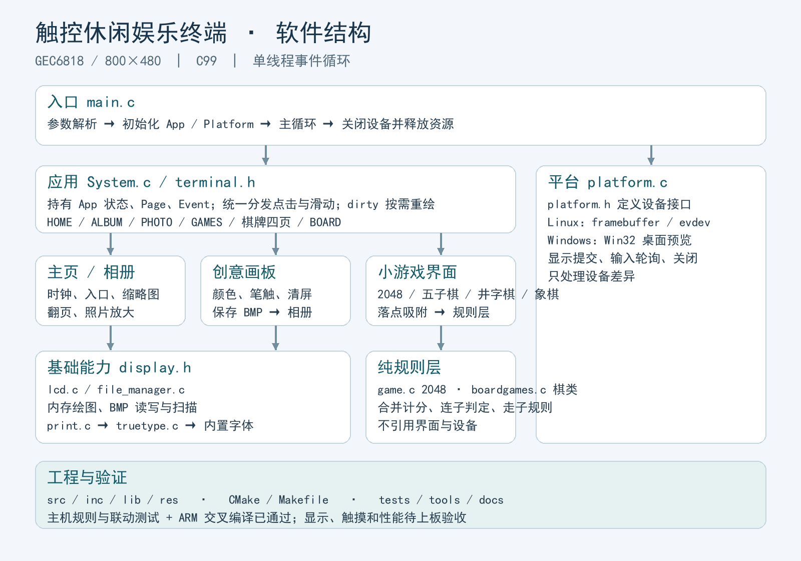
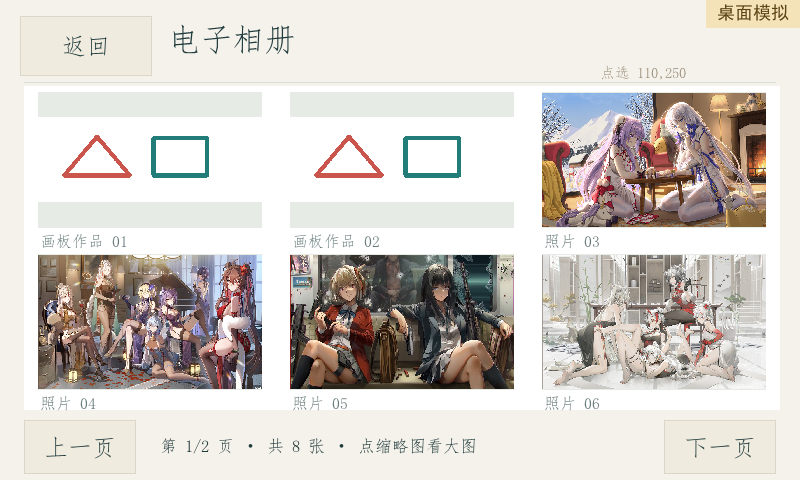
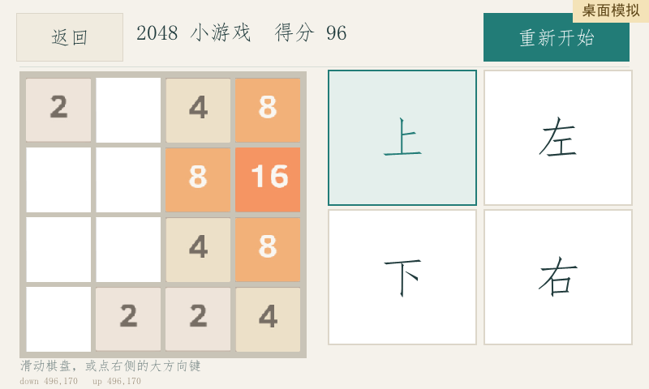
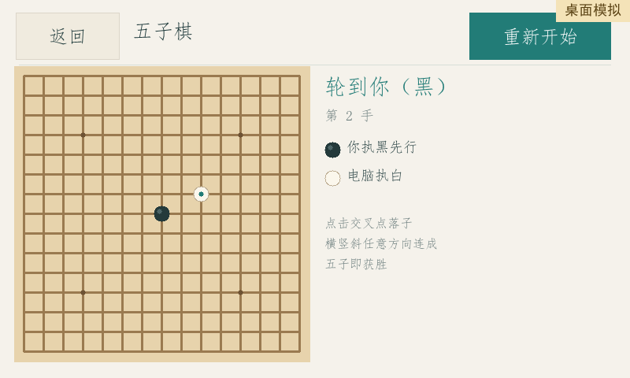
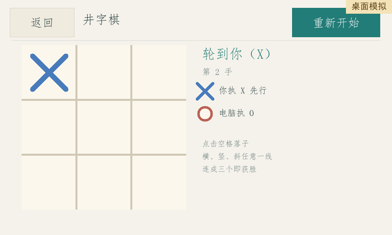
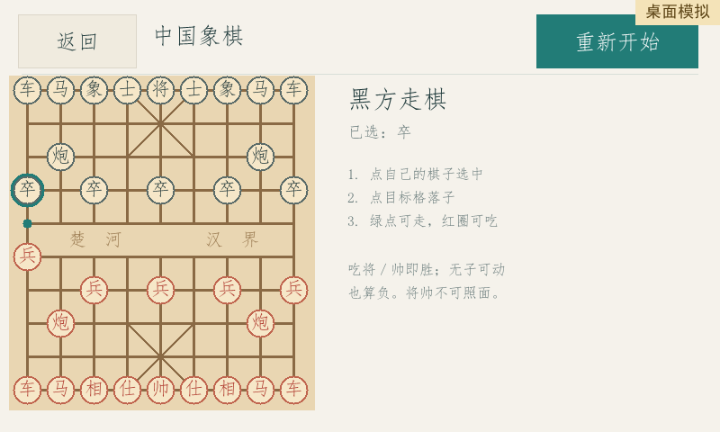

# 基于嵌入式 Linux 的触控休闲娱乐终端设计与实现

学生姓名：________________　班级：________________

指导教师：________________　完成日期：2026 年 11 月

版本：课程演示版 1.0.0

## 摘要

本项目面向 GEC6818 开发板及 800×480 触摸屏，设计一个集电子相册、2048 游戏与创意画板于一体的触控休闲娱乐终端。系统采用嵌入式 Linux、C99、framebuffer 和 evdev 实现显示及输入，以本地资源和文件保存为基础，无需网络或媒体播放器。主界面提供日期时间和功能入口，用户通过点击与滑动完成照片浏览、数字合并和绘画创作。

项目在所提供的谢东宏、肖林祥多媒体终端工程基础上改编：保留显示、相册、白板、字体和 2048 的可用设计及资源，移除音乐与视频模块；登录页保留为本地数字账号校验，四款小游戏共用一套规则层，统一事件分发与资源管理。已完成 Windows 桌面构建、功能回归及 ARM 静态程序交叉编译。当前截图来自相同 C 实现的桌面模拟，尚未进行 GEC6818 实机验证；演示视频由学生自行录制。

关键词：嵌入式 Linux；GEC6818；触摸交互；电子相册；2048；电子画板

## 一、选题背景与目标

嵌入式触控终端能够将显示、输入、文件管理与应用逻辑集中在一块设备上，适合通过课程项目练习 Linux 设备访问和 C 语言模块化开发。为了控制实现和演示难度，本项目聚焦于无需音视频解码的休闲应用，减少第三方依赖，并使用已有工程的素材和成熟思路缩短开发周期。

目标是形成一个可构建、可解释、可演示的课程工程：以统一主页组织各功能；以相册与画板的文件联动体现模块协作；以 2048 展示状态机和算法；以单线程事件循环降低多模块竞争输入和绘图的复杂度。项目书、构建配置、验证记录和演示材料与实际实现保持一致。

本项目为课程改编作品，原作者归属、采用范围和资源来源列于复用说明。学生提交前应填写封面信息，理解主要代码并补充本人实机验收记录，不把来源素材或工具改动记录替代个人工作说明。

## 二、需求分析

### 2.1 功能需求

| 编号 | 功能 | 实现要求 |
| --- | --- | --- |
| F01 | 主页与时钟 | 显示本地日期、时分秒；进入相册、游戏、画板；正常退出 |
| F02 | 电子相册 | 每页 6 张缩略图；前后翻页；点击后等比放大；上一张/下一张循环浏览 |
| F03 | 2048 | 4×4 棋盘；开始与重开；方向按钮和滑动；合并、累计得分与胜负提示 |
| F04 | 五子棋 | 15×15 交叉点；玩家执黑先行、电脑执白应手；横竖斜五连判胜，点已占格无效 |
| F05 | 井字棋 | 3×3 大格；玩家执 X 先行、电脑全树搜索应手；三连判胜、满格判和 |
| F06 | 中国象棋 | 9×10 双人同屏；将/士/象/马/车/炮/兵完整走子规则；吃将或困毙判负 |
| F07 | 创意画板 | 颜色、笔触粗细、连续画线、白色擦除、清屏及 BMP 保存 |
| F08 | 功能联动 | 保存后的画作自动在下一次进入相册时收录；已保存文件重启后保留 |

### 2.2 工程与交付要求

源代码按职责和类型组织：C 实现在 src，公共头文件在 inc，资源在 res，库说明在 lib。提供 Makefile 和 CMake，能够执行桌面测试及 ARM 交叉编译。交付项目书、成果演示、程序框架讲解和部署验收说明。Git 在派生工程内本地管理，不修改原作者工程或向外部仓库发布。

### 2.3 范围与限制

不实现音乐、视频、网络服务和数据库；登录只在本地 data/accounts.txt 做 6 位数字账号比对，不含注册审核、找回或权限分级。相册只读取未压缩的 24/32 位 BMP，最多收录 128 张，单边最多 4096 像素且总像素不超过 8 Mi；超出或损坏文件显示读取失败。没有自动轮播、双指缩放、画板撤销或游戏断点存档。

返回首页保留本次进程内的画布和棋盘。退出后只保留已保存作品；系统时间由 Linux 配置，不进行网络校时。性能指标需要通过实际开发板测量，桌面效果不能作为触摸延迟、帧率或稳定性结论。

## 三、硬件与开发环境

### 3.1 硬件方案

目标硬件为 GEC6818 开发板和 800×480 触摸屏。应用使用 Linux 已有 framebuffer 驱动和触摸输入驱动，不修改内核、引脚或电路。LCD 通过 `/dev/fb0` 等节点访问，触摸通过 `/dev/input/eventN` 读取，程序参数允许适配实际节点。

显示后端支持 packed pixels、true color 的 16/32 bpp 格式，依据驱动报告的 RGB bitfield、行跨度和可视偏移写入映射内存。对不符合要求的布局拒绝启动，避免以固定 800×480×4 假设覆盖设备内存。触摸坐标由驱动轴范围归一化，可用交换 XY 和轴反转参数校正方向。

### 3.2 软件环境

开发主机为 Windows；使用 MinGW GCC 16 和 CMake 4.3.3 构建桌面预览。板端提供传统 ARM GCC 的 Makefile/CMake 配置，并以 Zig 0.13.0 交叉编译获得 ARMv7-A、EABI soft-float、静态 musl 可执行程序。静态链接减少对开发板动态 C 库版本的依赖，但不能代替实机兼容性测试。

项目文档生成使用 Python、Pillow 与 python-docx。它们仅用于主机资料生成，目标板程序不需要安装 Python 或这些工具。桌面预览使用 Win32 窗口承载同一块 C 绘制的像素缓冲。演示视频由学生自行录制。

## 四、软件总体设计

### 4.1 结构与职责

main.c 是程序入口，处理命令参数，依次创建应用和平台，运行循环，最后关闭设备及释放资源。System.c 持有 App 和页面状态，统一完成点击判定、事件路由、时钟检查和页面绘制。页面模块只描述各自功能，不直接打开 framebuffer 或触摸设备。

display.h 定义内存图像、矩形、绘图、BMP 和文字接口；platform.h 定义设备打开、输入轮询、提交像素和关闭。Linux 与 Windows 的设备差异封装在 platform.c 的条件编译分支。game.h/game.c 只维护棋盘、得分和随机状态，独立于绘图和硬件。

### 4.2 主循环与资源管理

系统采用单线程事件循环，避免各页面分别读取输入或同时写屏。主循环先检查时钟，必要时重绘 dirty 页面，再等待输入并分发。输入轮询的等待上限为 16 ms，此数值只是等待配置，不是整机响应或帧率保证。

App 拥有屏幕、画布、数字图片、棋盘和相册缓存；模块释放函数接受空对象，以便初始化失败时回滚。平台关闭在图像释放之前完成，避免窗口或设备仍引用已释放缓冲。信号处理只设置停止标志，不在信号回调内操作堆内存或图形。

### 4.3 输入和页面状态

页面状态包括 HOME、ALBUM、PHOTO、GAME、BOARD。平台层生成 DOWN、MOVE、UP、CANCEL 和 QUIT 事件。System 记录按下位置，按下与松开都在按钮内才触发操作，拖出后松开不误激活。输入队列丢报时取消当前手势，避免画板继续使用失效触点。

## 五、功能模块设计与实现

### 5.1 主界面

主界面显示日期时间，使用三个面积较大的卡片入口。点击后进入对应应用，各功能页左上角提供统一返回。日期和时钟来自系统本地时间，每秒需要时标记页面重绘，未使用专用时钟线程。

### 5.2 电子相册

进入相册时先扫描作品保存目录，再扫描 res/Album 中的内置照片。作品按文件名倒序排列；以时间戳命名时便于查看近期作品。每页缓存 6 张 224×116 缩略图，加载缩略图后释放原尺寸临时缓冲。大图按可用区域等比例显示，上一张和下一张在首尾循环。

文件扫描仅收录常规 BMP 文件，路径和数量均有固定容量。无法解码的图片显示错误提示，仍可以切换或返回。该处理使损坏文件不会被误当成正常图像，但不提供在线修复或格式转换。

### 5.3 2048 游戏

棋盘使用 16 个格子的指数表示：0 为空，1 表示 2，11 表示 2048。四个方向通过坐标映射复用同一条“向前压缩—相邻合并—补零”算法。每次滑动中，一个输入数字最多参与一次合并，例如 2、2、4 向左后得到 4、4，而不会立即得到 8。

合并得到的数值计入总分；只有棋盘发生变化才生成一个 2 或 4。得到 2048 后显示成功，无空位且没有相同相邻数字时判失败。游戏提供方向按钮和棋盘区域滑动，两者最终调用同一个 game_move 接口。重新开始重置得分和棋盘。

### 5.4 棋类小游戏

五子棋、井字棋、中国象棋的规则集中在 boardgames.c，页面文件只负责把屏幕坐标换算成棋盘下标并绘制，规则层不引用 display.h，因此 tests/test_boards.c 只链接这一个文件即可验证。

五子棋 15×15、交叉点间距 25 像素，整盘作为一个大目标按就近吸附，点击不会因为偏几像素而丢失。玩家执黑先行，电脑白方按四方向"连子数 + 开放端数"打分：四连活三权重最高，攻击分乘 2、防守分乘 1.5 并加少量随机，既会堵活四，也可能主动做五。井字棋九格只有 9 个空格，电脑用全树搜索，胜负按步数折价（越早赢分越高），因此玩家先手最好也只能和棋。中国象棋按标准走子实现，包含蹩马腿、塞象眼、象不过河、炮吃子须隔一子、兵过河后可横走；将帅照面用"先落子、再判定、后回退"的方式检查，不额外预测局面；吃将直接终局，走完一手后若对方无子可动同样判负。

界面统一为左侧棋盘、右侧状态栏、右上角"重新开始"。选中棋子后用绿点标出空位、红圈标出可吃子，非法走法不改变局面并在右下角提示触点坐标，便于上板排查触摸偏差。

### 5.5 创意画板及相册联动

画布尺寸为 752×286，工具栏位于画布外。提供 7 种颜色和 3 档笔触，白色用于擦除。用圆形笔触盖印，并通过 Bresenham 线段连接稀疏触摸样本，降低快速移动时出现断线的可能。手势离开画布后停止该段连线，避免跨越工具栏绘制。

保存时只写画布，输出标准 24 位 BMP。文件名由时间戳和查重后缀构成，避免同一秒连续保存覆盖；写入失败显示目录权限或空间提示。下一次进入相册重新扫描作品目录，因此联动通过文件完成，无需画板直接修改相册内部结构。

### 5.6 通用图像与字体

图形基础模块完成矩形、圆、线段、图像缩放及裁剪。BMP 处理显式读取小端字段，核查文件头、尺寸、像素偏移和实际文件长度，支持行填充与负高度。图片总分配量有上限，解码失败不保留半成品。

中文文字使用原工程字体及 TrueType 栅格器；加载一次字体，绘制时生成字形并在边界内混合像素。上游栅格器只用于可信的工程内置字体，不面向任意外部字体输入。

## 六、工程管理与原项目改编

谢版提供了系统、主界面、相册、白板、字体和图片等基础；肖版提供了 2048 指数表示、棋盘与数字素材。本次沿用相关文件名和功能边界，并重写事件组织、设备访问与易出错的合并/图片边界处理。具体对照见《复用与改动说明》，不是将两份工程直接拼接后改名。

CMake 构建 terminal、terminal_core、upstream_font 和桌面测试目标；应用与规则代码启用 C99 和严格告警。Makefile 提供常见 ARM GCC 工作流；头文件依赖由编译器生成。派生工程在本地 Git 管理，可使用 git diff、git log 审阅后续变更；不修改原工程版本记录。

代码保留 UTF-8 基线，原字体源码保持原样。新增的自动检查能判断文件位置、资源完整性和显式平台依赖，人工仍需审查职责划分、设备效果、资源来源和实际运行表现。

## 七、验证方法与当前结果

### 7.1 主机自动验证

| 验证项 | 方法与结果 |
| --- | --- |
| 桌面构建 | MinGW Release 构建通过，项目代码告警视为错误 |
| 游戏规则 | 四方向、单次合并、无效移动、计分、胜负、20000 次质量守恒检查通过 |
| BMP 边界 | 奇数宽度行填充、负高度、32 位高字节、坏文件、截断、非法尺寸和边缘裁剪通过 |
| 页面联动 | 选色与笔触、保存两份不同文件、相册分页、大图切换、重开、拖出及取消输入通过 |
| ARM 交叉编译 | ELF32 little-endian ARM、EABI5 soft-float，静态链接文件已生成 |
| 来源保护 | 谢版清单 74 文件、肖版清单 13 文件哈希复查一致 |

截图由测试驱动实际 C 渲染缓冲生成，并进行桌面画面检查；它能说明当前界面布局与软件调用链，不能证明真实屏幕色彩、触摸精度和硬件性能。详细命令、日志和边界见 docs/validation。

### 7.2 实机待验证

目前没有开发板连接和板上执行证据。LCD 节点、触摸节点、坐标方向、真实 16/32 位显示、目录可写、异常输入、连续运行稳定性以及已保存作品重启可读，均需按照《部署与验收》逐项记录。ARM 编译成功仅说明源代码可为该目标生成程序。

### 7.3 演示材料

演示视频由学生自行录制，工程提供《演示讲稿》供准备。成果演示展示主页、相册、2048，以及画板保存后进入相册查看的完整流程；框架讲解对应实际源文件、分层结构和主循环。桌面录制须注明桌面模拟；实机录像在完成板上验收后拍摄。

## 八、主要问题及处理

多模块输入和绘制的所有权容易混乱，因此统一到 System 和单循环。不同 framebuffer 的像素布局可能不同，因此读取真实 bitfield、跨度和偏移。触摸量程不一定等于 800×480，因此根据驱动范围缩放并支持方向参数。

BMP 行填充和有符号字节可能导致偏色或越界，因此使用无符号字段和明确的边界检查。2048 连续合并可能重复使用同一数字，因此先生成紧凑行再按相邻对合并。画作保存与相册状态同步容易耦合，因此在相册入口扫描保存目录。

上述问题已有源代码层面的处理和主机验证。设备驱动行为、文件系统异常与目标平台性能仍保留实机验证项，不用软件模拟替代这些结果。

## 九、后续工作与交付清单

下一步在 GEC6818 上检查设备节点和方向参数，完成连续操作及存储验收，补充真实照片、启动日志和实机成果视频。若课程后续需要，可另行评估自动轮播、撤销和进度存档；这些不是本版已实现功能。

本版交付源码工程、桌面运行包、ARM 板端运行包、Markdown/Word 项目书、原项目复用说明、框架图、部署验收表、自动测试、验证记录和视频录制提纲。视频由学生自行录制。项目书中设计、实现、主机验证和实机待验证的状态分别标注。

## 参考材料

1. 用户提供：谢东宏，多媒体娱乐终端 project，来源见 docs/upstream-files.json。
2. 用户提供：肖林祥，多媒体娱乐终端 project，来源见 docs/upstream-xiao.json。
3. 工作区《项目要求.txt》及教师要求截图：分层、构建管理、项目书和演示材料。
4. Linux framebuffer 与 input/evdev 接口说明，配合板卡 SDK 的实际驱动配置使用。
5. CMake、GCC 和 Zig 构建工具文档，工具版本及命令见项目验证记录。
