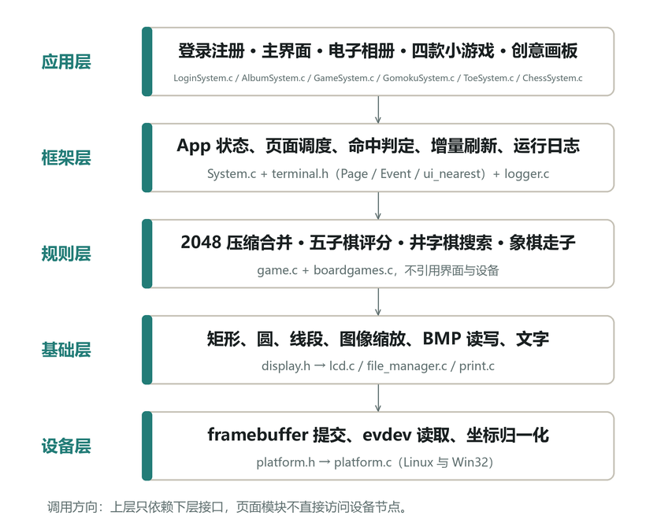
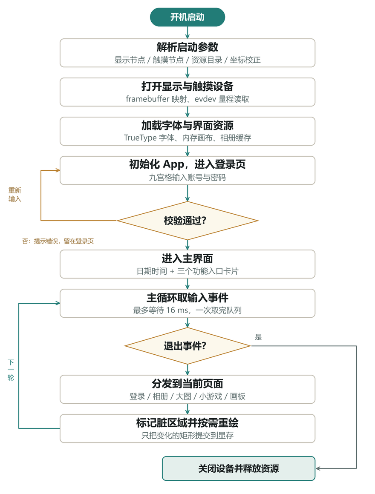
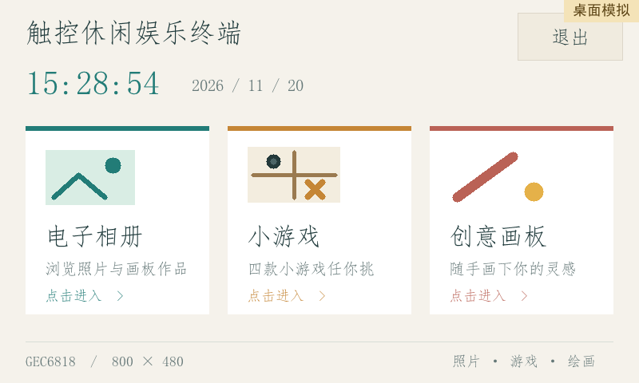
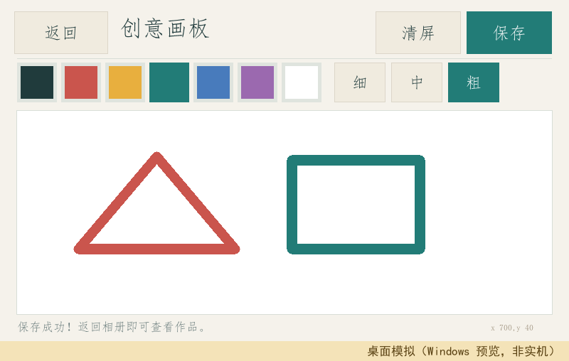
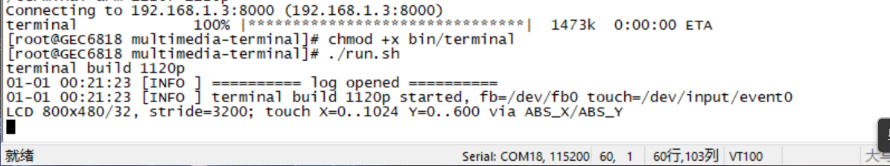
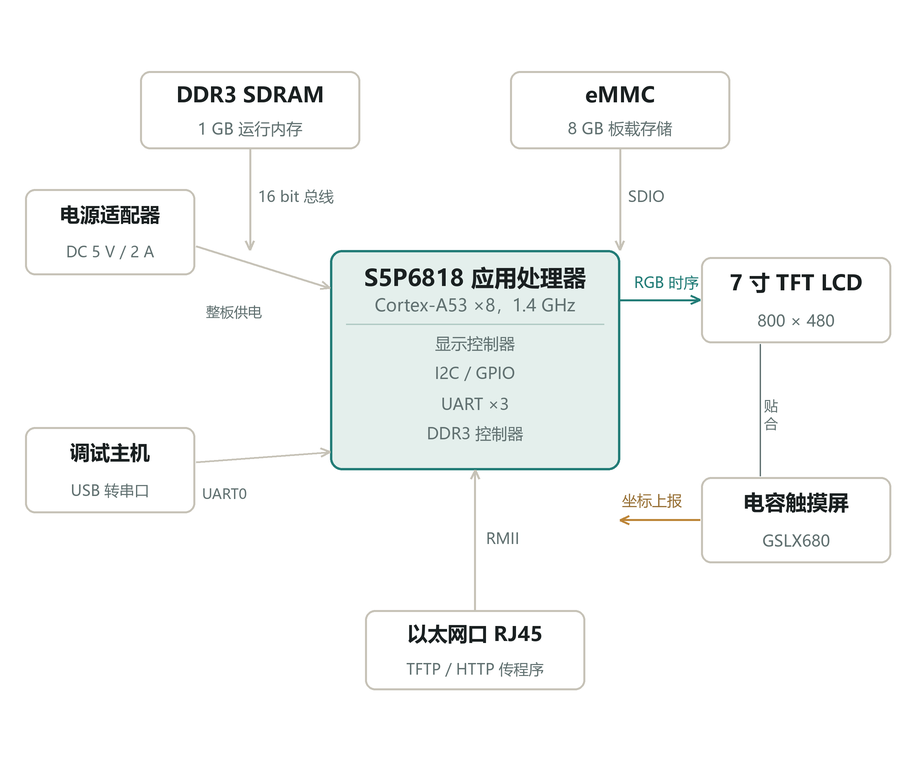

# 基于嵌入式 Linux 的交互式多媒体终端设计与实现

姓名：____________　班级：____________　日期：2026 年 11 月

## 一、项目概述

本项目面向 GEC6818 开发板（S5P6818，Cortex-A53，800×480 触摸屏），用 C99 实现一个本地运行的交互式多媒体终端。功能包括数字账号登录、带时钟的主界面、电子相册、四款小游戏（2048／五子棋／井字棋／中国象棋）、创意画板，以及记录运行过程的应用日志。画板保存的 BMP 会被相册自动收录，形成文件级的模块联动。

程序基于 Linux framebuffer 与 evdev 直接读写显示和触摸，不依赖 Qt、SDL、播放器或网络。已在 GEC6818 上实际运行验证。所用样机屏幕存在一条局部触摸失效横带，属于硬件故障；软件通过把可交互控件集中在可点击区域来规避，并在本书记载实测证据。

## 二、需求

| 编号 | 需求 | 验收标准 |
| --- | --- | --- |
| R1 | 登录 | 6 位数字账号密码校验，账号存于本地文件；演示账号 678678 |
| R2 | 主界面 | 显示日期时间，三个入口：相册、小游戏、画板 |
| R3 | 电子相册 | 每页 6 张缩略图，翻页、放大、前后张；自动收录画板作品 |
| R4 | 小游戏 | 四款可进入、可操作、可重新开局；2048 支持滑动；棋类有胜负判定 |
| R5 | 创意画板 | 7 色、3 档笔触、连续画线、白色擦除、清屏、保存 BMP |
| R6 | 运行日志 | 记录启动、页面切换、登录、保存；写文件与串口，文件大小有上限 |
| R7 | 工程 | 源码分层（src/inc/lib/res），CMake 与 Makefile 均可构建，自动化测试通过 |

不做音乐、视频、网络与数据库；登录不含权限分级与找回；相册只读取未压缩的 24/32 位 BMP，最多 128 张。

## 三、实现功能

### 3.1 功能结构

程序分为五层：应用层是各功能页面；框架层维护 App 状态、页面调度与命中判定；规则层实现 2048 与棋类算法，不引用界面与设备；基础层提供绘图、BMP 与文字；设备层封装 framebuffer 与 evdev。调用方向单向向下。

### 3.2 主流程

开机后解析参数、打开设备、加载字体与资源、进入登录页；校验通过后进入主界面。主循环最多等待 16 ms 取一次输入，一次取完整批事件再分发到当前页面，只把变化的矩形提交显存，收到退出事件时关闭设备并释放资源。

### 3.3 主要页面

| 页面 | 实现要点 |
| --- | --- |
| 登录 | 九宫格数字键盘；按下点、中间点、抬起点三点容错命中；错误时显示原因 |
| 相册 | 扫描内置图片与作品目录；每页缓存 6 张缩略图；放大图等比显示、首尾循环 |
| 2048 | 4×4 棋盘用 2 的指数表示；四方向复用压缩—合并—补零算法；一个数字每步只合并一次 |
| 五子棋 | 15×15 交叉点；四方向连子数与开放端评分；防守权重高于进攻 |
| 井字棋 | 3×3；玩家执 X 先行，电脑全树搜索，玩家先手最好只能和棋 |
| 中国象棋 | 9×10 双人同屏；含蹩马腿、塞象眼、炮架、将帅照面与困毙判定 |
| 画板 | 圆形笔触盖印加线段插值；白色擦除；保存为 24 位 BMP |
| 运行日志 | ERROR/WARN/INFO/DEBUG 四级；同时写 `data/app.log` 与串口；64 KiB 上限自动轮转 |

## 四、软件介绍

开发环境为 Windows，使用 MinGW GCC 与 CMake 构建桌面预览；板端用 Zig 0.13.0 交叉编译为 ARMv7-A、EABI5 soft-float、静态链接 musl 的 ELF 程序，避免依赖板上的动态 C 库版本。Makefile 提供传统 ARM GCC 工作流。

源码组织：`src/` 放实现、`inc/` 放头文件、`lib/` 放第三方库说明、`res/` 放字体与图片、`tests/` 放回归测试、`tools/` 放构建与文档脚本。第三方 stb_truetype 用于渲染内置中文字体，保持上游源码原样。

单线程事件循环统一处理输入，避免多模块竞争；命中判定采用三点容错，适配这块面板按下与抬起不报同一位置的特性。BMP 读写按小端逐字节解析，检查文件头、行对齐、尺寸与文件长度；解码失败不留半成品。自动测试覆盖规则、BMP 边界、页面联动、登录流程与日志轮转，当前 5 项全部通过。

## 五、硬件介绍

主控为 S5P6818（8 核 Cortex-A53，1.4 GHz），配 1 GB DDR3 与 8 GB eMMC。7 寸 TFT LCD 通过 RGB 时序连接，分辨率 800×480；电容触摸屏 GSLX680 贴合在屏上，通过 I2C 上报坐标。调试主机经 USB 转串口接 UART0；以太网 RJ45 用于 TFTP／HTTP 传程序；5 V／2 A 电源适配器整板供电。

软件不修改内核与引脚，只访问 Linux 已有驱动节点：显示用 `/dev/fb0`，触摸用 `/dev/input/eventN`。显示层读取驱动报告的位域、行跨度与可视偏移，而不是假设固定 800×480×4 布局，布局不符则拒绝启动。触摸层读取 `EV_ABS` 的 `ABS_X/ABS_Y` 坐标与 `EV_KEY/BTN_TOUCH` 接触标志，按驱动声明量程线性映射到屏幕；标定数据在加载时与声明量程比对，跨度差异过大就忽略。

## 六、问题及解决

以下六条均来自实际调试记录，附构建号与实测数据。

**问题 1：井字棋看不到电脑的圆（构建 1120n）。** `draw_disc` 对半径大于 32 的调用直接返回、不画任何像素且不报错。井字棋棋子半径写的是 34，所以电脑的每个 O 都被丢弃；玩家的 X 由线段绘制、图例的 O 半径 16，都正常，现象就成了「只看见自己的叉」。像素统计：修复前目标格红色像素 0 个，修复后 1304 个。解决：半径改为 30；扫描全部调用点确认无其他越界；在 `lcd.c` 注释中写明该静默丢弃行为。

**问题 2：2048、五子棋点不进去（构建 1120n）。** 四张游戏卡片原为 2×2 排布，上排位于 y 104..256，实测这段点不动。对照五个已知控件的可用性：画板工具栏 y 16..76 可用，键盘 1/2/3 的 y 190..250 不可用，键盘 4/5/6 的 y 258..318 可用。据此判定失效带下边界在 y≈257。解决：四张卡改为竖排四行，从 y 260 到 478，全部落在可用区；上方只放说明文字，不放按钮。测试里的四处点击坐标同步更新。

**问题 3：触摸屏中段失效是硬件问题，不是程序问题（构建 1120f→1120n）。** 初期怀疑映射算法，连续四版修正都无效。最终做同屏对照：把第三方同学**自己编译的原版 ARM 二进制**（124612 字节，未修改）放在**同一块屏**上运行，结果同样注册不了、同样上半部点不动。两套独立代码、相似的触摸读取方式，症状重合只能来自面板。证据链：25 次采样中 rawY 只落在 326..330 与 456..571，中间 126 个单位一次都没有；屏幕 y 只出现五档，键盘行距 68 像素被压成同一档；无 `ABS_MT_POSITION_Y` 备用通道；`SYN_DROPPED` 全程为 0。解决：确认软件无法补出这段位置，改为版式避让；删除槽号过滤、坐标锁、丢包取消、标定优先四层无效逻辑；演示账号改用 678678，避开按不出的 1/2/3。

**问题 4：一份错误的标定记录把上半屏拖出可点范围（构建 1120f→1120g）。** 早期用屏幕下半屏两点拟合的 `touch.cal` 参与映射，把上半屏坐标整体拉偏。解决：默认采用驱动声明量程，标定改为 `--calibrate` 按需触发；加载已有记录时与声明量程比对，跨度相差超过 1/7 或起点相差超过 1/10 即忽略并打印原因；靶心从下半屏改到四角加正中心，中心点作为独立检验。

**问题 5：ARM 编译出现"假成功"（构建脚本）。** PowerShell 5.1 下 `$ErrorActionPreference='Stop'` 会把原生命令写入 stderr 的普通进度信息当作终止错误，导致编译失败时旧二进制仍留在原地，脚本却打印成功。另有 `zig cc ... | head` 的退出码来自 `head`，掩盖了编译错误。解决：构建函数改为读取 `$LASTEXITCODE` 并检查产物修改时间，链接阶段不接管道；现在编译失败必然报错。

**问题 6：BMP 解码的边界错误。** 早期实现依赖结构体对齐，遇到奇数宽度行填充、自底向上存储和负高度时会偏色或越界。解决：按小端逐字节读写，显式处理 4 字节行对齐与存储方向，检查文件实际长度能否覆盖像素区，失败时清理已分配内存与残留文件。回归测试覆盖奇数宽度、负高度、32 位高字节、坏文件与截断输入。

**已如实注明的限制**：样机屏的失效带无法在软件层修复，失效区内的坐标精度、真实丢包率、长时间运行稳定性等指标未能在这块屏上完整测量，不以桌面模拟结果替代。
